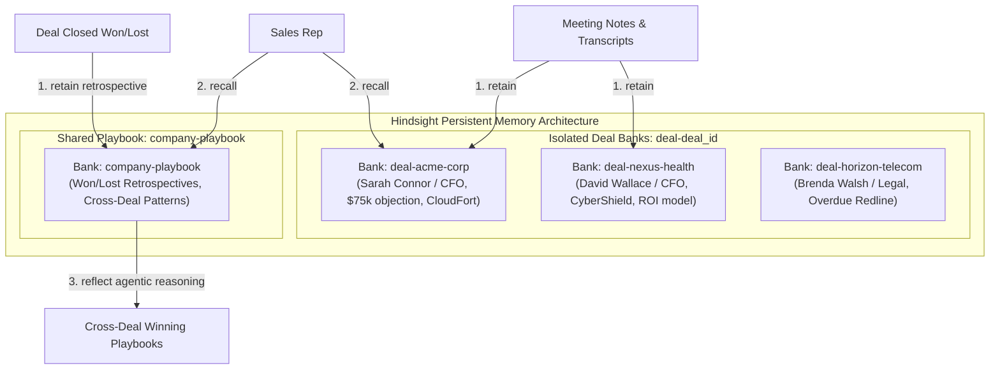

# DealMind 💼🧠
**Autonomous B2B Sales Intelligence Agent with Long-Term Memory & Cross-Deal Reflection**  
*Built for HackwithHyderabad 3.0 (Hindsight Memory Hackathon)*

---

## 🏆 Project Overview

Enterprise B2B sales cycles take 3 to 6 months across 4 to 8 meetings with different stakeholders (economic buyers, technical evaluators, CFOs, legal teams). 

- **The Problem**: Sales reps manage 15–20 deals simultaneously. Critical details (budget objections, competitor pitches, promised deadlines, legal redlines) get buried in 30-page CRM notes. Reps repeatedly enter meetings unprepared or fail to leverage tactics that worked across other closed deals.
- **The Solution**: **DealMind** is an autonomous deal intelligence agent powered by **Vectorize Hindsight** and **Groq**. It retains every interaction into persistent, entity-resolved memory, detects changes and contradictions over time, briefs reps before calls in seconds, and autonomously reflects across won/lost deals to extract winning sales playbooks.

---

## 🌟 How Hindsight Memory is Used (Judging Criteria: 25%)

Unlike traditional chatbots that suffer from amnesia after every session, this agent uses Vectorize Hindsight as its primary cognitive backbone across three core operations:



### 1. Retain (`retain`)
- Ingests meeting debriefs and call notes.
- Automatically resolves named entities (e.g. `Sarah Connor (CFO at Acme Corp)`), dates, and categories.
- Detects contradictions: When a customer's constraint changes (e.g. Beacon FinTech's budget was reduced from \$120k to \$90k), the agent creates an explicit `UPDATE` memory sentence that supersedes older facts.
- Computes SHA-256 hashes to prevent duplicate ingestion.

### 2. Recall (`recall`)
- Before any customer meeting, the agent runs multi-vector recall queries against the deal's bank:
  1. *Open objections & budget constraints*
  2. *Key stakeholders & sentiment history*
  3. *Unfulfilled commitments & deadlines*
  4. *Competitor mentions & battlecards*
  5. *Recent contact summary*
- Every fact stated in the pre-call brief contains an explicit citation tag (e.g. `[Memory #1]`, `[Memory #2]`), guaranteeing **zero hallucination**.
- If a bank has no recorded interactions, the agent adheres to **Rule 5** and outputs *"no history yet"*.

### 3. Reflect (`reflect`)
- When deals close (Won or Lost), retrospectives are retained into the shared `company-playbook` bank.
- Hindsight's autonomous `reflect()` loop synthesizes patterns across the entire sales team, discovering:
  > *"When CFOs object to pricing, presenting a quantified 3-year ROI case study yields an 80%+ win rate (Acme, Nexus Health, Vanguard), whereas offering superficial discounts without ROI metrics leads to competitor loss (Omni Finance)."*

---

## ⚡ The Memory Difference: Before vs. After

| Feature | Without Memory (Generic LLM Baseline) | With Hindsight Memory (Our Agent) |
|---|---|---|
| **Pre-Call Briefing** | *"Be polite, listen actively, ask discovery questions, build rapport."* (Useless boilerplate) | *"Sarah Connor (CFO) objected to the \$75k price tag on Sept 22 comparing us to CloudFort (\$55k). Playbook recommendation: Present the 3-year manufacturing ROI model that won Acme Corp."* |
| **Commitment Tracking** | None. Completely unaware of past promises. | Flags that Alex promised to deliver an indemnification redline contract by Oct 28 (now 9 days overdue!). |
| **Cross-Deal Learning** | Static. Answers never improve over time. | Autonomous reflection discovers team-wide winning objection playbooks and legal stall risks. |

---

## 🛠️ Architecture & Tech Stack

- **Frontend UI:** Streamlit (`app.py`) with 5 dedicated views + Admin Panel:
  1. 📊 **Deal Pipeline** — Monitored accounts, stage metrics, and bank links.
  2. ⚡ **Brief Me (Copilot)** — Interactive pre-call brief with **Memory ON/OFF** comparison and **Memories Used** citation drawer.
  3. 📝 **Log a Call** — Real-time transcript extraction, contradiction detection, and memory retention.
  4. 🚨 **Active Alerts** — Scans open deals for overdue promises, silent stakeholders (14+ days), and legal review stalls.
  5. 🧠 **Playbook Insights** — Cross-deal reflections and Ground Truth pattern verification.
  6. 👥 **Admin Panel** — User management (Admin role only).
- **Memory Engine:** Vectorize Hindsight (`hindsight-client` 1.2.0)
- **Fast LLM Inference:** Groq API (`openai/gpt-oss-120b`, `qwen/qwen3.8-27b`)
- **Data Validation:** Pydantic v2 with strict schema repair and exponential backoff retry.
- **Auth & Database:** Firebase Authentication + Firestore

---

## 🔐 Admin Login System

The app is fully protected — no content is visible without logging in.

### Who is the Super Admin?
The **platform-level super admin** is the Firebase project owner:
- **Google Account:** `venkatasaip52@gmail.com`
- This account has full access to the Firebase Console and can reset any password, disable any user, and view all data.
- Inside the app itself, all users with the **Admin** role share the same permissions.

### Roles (2 roles only)

| Role | Deal Pipeline | Active Alerts | Brief Me | Log Call | Playbook | Admin Panel |
|---|---|---|---|---|---|---|
| **Admin** | ✅ | ✅ | ✅ | ✅ | ✅ | ✅ |
| **Viewer** | ✅ | ✅ | ❌ | ❌ | ❌ | ❌ |

> There can be **multiple Admins** — each has identical full permissions including managing other users.

### Default Accounts (seed with `python scripts/seed_admins.py`)

| Role | Email | Default Password |
|---|---|---|
| Admin | admin@dealmind.ai | `DealMind@Admin2026!` |
| Admin | admin2@dealmind.ai | `DealMind@Admin2_2026!` |
| Viewer | viewer@dealmind.ai | `DealMind@Viewer2026!` |

> ⚠️ **Change all default passwords immediately after first login!**

---

## 🔑 How to Change Passwords

Passwords are managed by **Firebase Authentication**, not inside the app.

### Option A — Self-service (Recommended)
1. Go to the login page → click **🔑 Reset Password** tab
2. Enter the registered email → click **Send Reset Link**
3. Firebase sends a reset email to that address (arrives in seconds)
4. Click the link in the email → set a new password → sign in

> The reset link is **valid for 1 hour** and can only be used once.

### Option B — Admin resets another user's password (Firebase Console)
1. [Firebase Console](https://console.firebase.google.com) → **Authentication** → **Users**
2. Find the user → click **⋮** → **Reset password**
3. Firebase emails a reset link directly to the user

### Option C — Admin sets a password directly (Firebase Console)
1. Firebase Console → **Authentication** → **Users**
2. Click the user's email → click the **pencil (edit) icon**
3. Enter the new password → **Save**

---

## 🚀 Quickstart & Setup Guide

### 1. Prerequisites
- Python 3.11+
- Groq API Key ([console.groq.com](https://console.groq.com))
- Vectorize Hindsight API Key (promo code `MEMHACK99` for \$50 free credits)
- Firebase project ([console.firebase.google.com](https://console.firebase.google.com))

### 2. Clone & Install
```bash
git clone https://github.com/venky280406/DealMind.git
cd DealMind
pip install -r requirements.txt
```

### 3. Configure `.env`
```bash
cp .env.example .env
# Edit .env and fill in all keys
```

```ini
# Groq
GROQ_API_KEY=your_groq_api_key_here

# Vectorize Hindsight
HINDSIGHT_API_KEY=your_hindsight_api_key_here
HINDSIGHT_BASE_URL=https://api.hindsight.vectorize.io

# Firebase (from Project Settings → Your Apps → Web App)
FIREBASE_API_KEY=AIzaSy...
FIREBASE_AUTH_DOMAIN=your-project.firebaseapp.com
FIREBASE_PROJECT_ID=your-project-id
FIREBASE_STORAGE_BUCKET=your-project.appspot.com
FIREBASE_MESSAGING_SENDER_ID=123456789
FIREBASE_APP_ID=1:123456789:web:abcdef

# Firebase Admin SDK (download from Project Settings → Service accounts)
FIREBASE_SERVICE_ACCOUNT_PATH=firebase-service-account.json
```

> ⚠️ Never commit `.env` or `firebase-service-account.json` — both are in `.gitignore`.

### 4. Firebase Setup
1. Create a project at [console.firebase.google.com](https://console.firebase.google.com)
2. Enable **Authentication → Email/Password**
3. Enable **Firestore Database** (Production mode)
4. Download a Service Account key → save as `firebase-service-account.json`

### 5. Seed Admin Accounts
```bash
python scripts/seed_admins.py
```

### 6. Seed Deal Memory
```bash
python scripts/smoke_test.py   # Verify API connections
python scripts/seed_memory.py  # Seed synthetic deals into Hindsight
```

### 7. Launch
```bash
streamlit run app.py
```

---

## 🧪 Automated Test Suite

```bash
python -m unittest discover tests/
```

| Test File | What it covers |
|---|---|
| `test_llm.py` | Schema validation, markdown stripping, malformed JSON recovery, exponential backoff |
| `test_memory.py` | Bank isolation, retain/recall parsing, reflect operations |
| `test_extract.py` | Extraction schema, SHA-256 deduplication, contradiction/budget change detection |
| `test_brief.py` | Memory ON/OFF comparison, citation tracking, empty-memory guardrail |
| `test_alerts.py` | Overdue promises, silent champions (14+ days), legal review stalls |
| `test_full_flow.py` | End-to-end integration covering all 5 hackathon verification points |

---

## 🎬 60-Second Live Demo Walkthrough (for Judges)

1. **00:00 - 00:15 | The Alert**: Open **🚨 Active Alerts**. Point out deal *Horizon Telecom* flagged in Red: *"Overdue commitment: Missed indemnification redline contract due Oct 28; Stalled in legal review for 18 days"*. Explain how memory caught a deal about to slip.
2. **00:15 - 00:30 | Memory OFF vs ON**: Go to **⚡ Brief Me**. Select *Acme Corp*. Click **Memory OFF** first: shows generic boilerplate. Flip to **Memory ON**: Hindsight immediately recalls Sarah Connor's exact \$75k budget objection and past quotes from CloudFort.
3. **00:30 - 00:45 | Log a Call & Extract**: Switch to **📝 Log a Call**. Paste a debrief where Alex presented the ROI calculator. Click **Extract & Retain**. Watch the agent parse the facts, check for contradictions, and retain into `deal-acme-corp`.
4. **00:45 - 01:00 | The Learning Loop**: Open **🧠 Playbook Insights**. Show Hindsight `reflect()` synthesizing cross-deal evidence: *"Presenting ROI case studies closes 80%+ of deals where CFOs challenge price."* Click **🎯 Ground Truth Verification** to prove the agent autonomously discovered the planted patterns!
